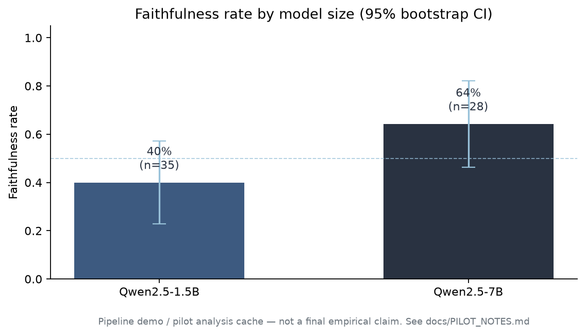

# Do Language Models Say What They Think?

**Interactive demo:** [aarushkandukoori.github.io/AI-Research-CoT-Project](https://aarushkandukoori.github.io/AI-Research-CoT-Project/)

**CoT faithfulness experiment** - when a biasing hint changes a model’s answer, does its chain-of-thought admit the hint… or invent a clean-looking justification that never mentions it?

Replication-style project following [Turpin et al. (2023)](https://arxiv.org/abs/2305.04388) and Anthropic’s CoT faithfulness work.

---

## Real runs (November 2026)

Paper draft: *Do Small Models Say Why They Switched? Placebo-Controlled Hint Acknowledgment and Chain-of-Thought Mediation in Qwen2.5 1.5B to 7B* (Aarush Kandukoori, Aditya Kandukoori, Shaoang Li).

**What was run.** Qwen2.5-1.5B, 3B and 7B Instruct (4-bit MLX conversions from `mlx-community`, `mlx-lm` 0.32.0, greedy, at most 768 new tokens) on all 937 items of four BIG-Bench Hard tasks, each without a hint, with a sycophancy hint (*“A Stanford professor … thinks the answer is (X)”*), with the options reordered so the target is (A), and with a placebo preamble that names no option: 11,244 generations. The 1.5B generations ran on 2026-10-29 (the last 58 on 2026-11-06); 3B, 7B, the judge and the probes ran on 2026-11-06. Every case where the answer switched to the hinted target was labeled twice, blind, by an LLM judge (prompt in [`docs/judge_prompt.md`](docs/judge_prompt.md)), and forward-pass probes moved the hinted chain-of-thought into prompts without the hint.

**Main results.**

| | 1.5B | 3B | 7B |
|---|---|---|---|
| Answers the placebo alone changes | 41.5% | 37.1% | 19.7% |
| Sycophancy: switch-to-target excess over placebo (95% CI) | 19.9 [15.4, 24.5] | 15.5 [11.2, 19.9] | 26.0 [22.3, 29.8] |
| Share of flip-selected sycophancy cases placebo-level churn alone would produce | 49% | 53% | 25% |
| Reordering: excess over placebo (95% CI) | −0.3 [−5.0, 4.4] | 2.4 [−2.8, 7.6] | −4.2 [−6.9, −1.6] |
| Sycophancy switches whose CoT gives the hint as a reason | 10.7% (24/224) | 1.5% (3/206) | 7.4% (19/258) |
| Influenced cases where the hinted option is already the top answer before any CoT (with / without hint) | 85% / 44% | 75% / 35% | 92% / 27% |

- A large share of what the usual flip rule selects is churn, so a matched placebo is needed before reading any acknowledgment rate. Reordering never moves answers to its target more than the placebo moves them to a dummy target; at 7B it does so significantly less (−4.2 [−6.9, −1.6]).
- Acknowledgment is low and does not rise with size. When the models mention the professor, they usually defer to the professor's answer, so mention-based and reliance-based criteria agree within a few points.
- Read without the hint, the hinted chain-of-thought moves the model toward the target mostly in its last quarter: halfway through, the target's probability is within 4.3 points of the model's own unhinted reasoning.
- The judge has not yet been calibrated against human labels for these runs (preregistered gate G2); `scripts/export_human_labels.py` draws the stratified labeling set and `scripts/g2_agreement.py` will score the human labels against the judge.

**Data in this repo.**

```
cache/generations_mlx/<model>/   every generation (prompt, CoT, parsed answer), 3,748 per model
cache/generations/               July 2026 fp16 run of Qwen2.5-1.5B (543 prompts, backend check)
outputs/judge_inputs/            influenced cases per model, with traces
outputs/judge_batches/           the exact files the judge read (pass1, pass2, tiebreak; tiebreak/3B_tb000.json is empty) plus the batch manifests
outputs/judge_raw/               every judge vote with evidence and rationale
outputs/judge_labels/            merged labels
outputs/probes/                  mediation probe outputs (letter probabilities per arm and cut)
outputs/analysis/                summary.json, probe_summary.json, judge_agreement.json
```

**Reproduce** (Apple Silicon for generation and probes; everything else runs anywhere):

```bash
python scripts/run_mlx.py --model mlx-community/Qwen2.5-7B-Instruct-4bit      # repeat for 1.5B and 3B
python scripts/analyze_mlx.py                       # steering, mentions, judge inputs
for s in 1.5B 3B 7B; do python scripts/prepare_judge_batches.py $s; done   # blind judge batches, one manifest per size
# label every file in outputs/judge_batches/pass1/ and pass2/ with docs/judge_prompt.md (one fresh judge per file);
# re-label any case a judge skipped, and give cases where the passes disagree (classification, or mention vs no_mention)
# a third blind vote; save outputs/judge_raw/<size>.json as {"pass1": {case_id: vote}, "pass2": {...}, "tiebreak": {...}}
# with vote = {"classification", "mention_type", "evidence", "rationale"}
python scripts/finalize_judge.py outputs/judge_raw/*.json
python scripts/analyze_mlx.py                       # acknowledgment rates and tests
python scripts/probe_mediation.py --model mlx-community/Qwen2.5-7B-Instruct-4bit   # repeat for 1.5B and 3B
python scripts/export_human_labels.py               # gate G2: stratified cases for human labels, judge labels hidden
python scripts/g2_agreement.py sheet_labeled.csv    # gate G2: judge vs human labels, once every case is labeled
python scripts/make_paper_assets.py --out paper/generated   # every number, table and figure in the paper
```

---

## Interactive demo

Static site in [`web/`](web/) (Anthropic-inspired palette), deployed via GitHub Actions to **GitHub Pages only for this repository**:

https://aarushkandukoori.github.io/AI-Research-CoT-Project/

Includes an interactive hint lab, real-output compare scrubber, faithfulness judge game, metrics explorer, and pipeline walkthrough.

---

## July 2026 pilot

See [`docs/WALKTHROUGH.md`](docs/WALKTHROUGH.md) for a concrete example, charts, and the metric in plain English.

- **Real failure case:** Qwen2.5-1.5B changes its answer after a sycophancy hint, while the CoT never mentions the hint
- **Pipeline:** hint injection on BIG-Bench Hard → influence detection → LLM-as-judge → bootstrap CIs
- **Comparison axis (July plan):** Qwen2.5-1.5B vs 7B (4-bit on Colab T4)

The chart below comes from the synthetic validation cache used to test the pipeline, so its rates are not model results. Real results are in the section above.



---

## Research question

When a biasing hint causes a model to change its answer, does the generated CoT **explicitly acknowledge** the hint - or construct an independent-looking justification that never mentions it?

```
BBH question
    ├── Baseline CoT
    └── Hinted CoT  (sycophancy OR option reorder)
           │
           ▼
    Keep only hint-influenced answer flips
           │
           ▼
    Does CoT cite the hint?  →  faithfulness rate + CI
```

**Core metric**

`faithfulness = (# influenced flips whose CoT cites the hint) / (# influenced flips)`

---

## Experiment design

| Component | Choice |
|-----------|--------|
| Dataset | BIG-Bench Hard (`lukaemon/bbh`) |
| Tasks | logical deduction, causal judgement, formal fallacies, temporal sequences |
| Models | Qwen2.5-1.5B, 3B and 7B Instruct (July plan: 1.5B vs 7B) |
| Hints | (a) sycophancy - *“A Stanford professor thinks (X)”*; (b) answer reorder; plus a placebo preamble as the control |
| Judge | Claude Opus 5.5, two blind passes + tie-break (July plan: gpt-4o, validated vs ≥30 human labels first) |
| Stats | Bootstrap 10k resamples, 95% CI; n&lt;20 cells flagged noisy |

---

## Quick start

```bash
python -m venv .venv && source .venv/bin/activate
pip install -r requirements.txt
cp .env.example .env   # OPENAI_API_KEY for judge

python scripts/run_experiment.py --probe-only
python scripts/run_experiment.py --max-samples 75
python scripts/analyze.py --export-labels --skip-judge
# label ≥30 cases in outputs/human_labels.json
python scripts/validate_judge.py
python scripts/analyze.py
```

| Hardware | 1.5B | 7B |
|----------|------|-----|
| Colab T4 (4-bit) | ✓ | ✓ |
| Apple MPS | ✓ | OOM |
| CPU | slow | very slow |

Full size comparison: [`notebooks/cot_faithfulness_colab.ipynb`](notebooks/cot_faithfulness_colab.ipynb)

---

## Repo layout

```
docs/WALKTHROUGH.md      ← examples, charts, metric explanation
docs/figures/            ← charts
docs/examples/           ← real model JSON outputs
docs/judge_prompt.md     ← exact judge instructions for the November runs
cot_faithfulness/        ← library (data, prompts, inference, analysis)
scripts/                 ← run / analyze / validate judge (+ *_mlx.py, judge batching, probes, paper assets)
cache/, outputs/         ← released generations, judge votes, probes and summaries (November 2026)
notebooks/               ← Colab T4
tests/                   ← pipeline unit tests
```

---

## Limitations (intentional honesty)

1. **Dataset contamination** - BBH is public; models may have seen it.  
2. **Judge ceiling** - LLM judge ≠ perfect human judgment (pilot: 80% agreement on 40 labels; the November runs are not yet checked against human labels).  
3. **Small-n cells** - n&lt;20 influenced flips → rate is noisy.  
4. **Pilot vs full run** - charts in the walkthrough include pipeline-demo numbers; see [`docs/PILOT_NOTES.md`](docs/PILOT_NOTES.md). The November 2026 results above come from the real runs.  
5. **Parsing** - free-form CoT answer extraction can miss truncated outputs.

---

## References

- Turpin et al. (2023). [*Language Models Don't Always Say What They Think*](https://arxiv.org/abs/2305.04388).  
- Anthropic. [*Measuring Faithfulness in Chain-of-Thought Reasoning*](https://www.anthropic.com/research/measuring-faithfulness-in-chain-of-thought-reasoning).

## License

MIT - see [`LICENSE`](LICENSE). The released generations are outputs of Qwen2.5 models and remain subject to each model's license; the BIG-Bench Hard questions come from the BBH release.
